# MUHAMMAD HASSAN
<h3><strong>Data Science &amp; Analytics</strong> · <strong>Edge Computer Vision</strong> · <strong>Financial Modeling</strong> · <strong>LLMs</strong></h3>

 

<strong>Languages</strong>

  

<strong>AI / ML</strong>

  

  
  

<strong>Tools &amp; Frameworks</strong>

  

  

<strong>Connect</strong>

  
  &nbsp;
  
  &nbsp;
  
   
  

 

